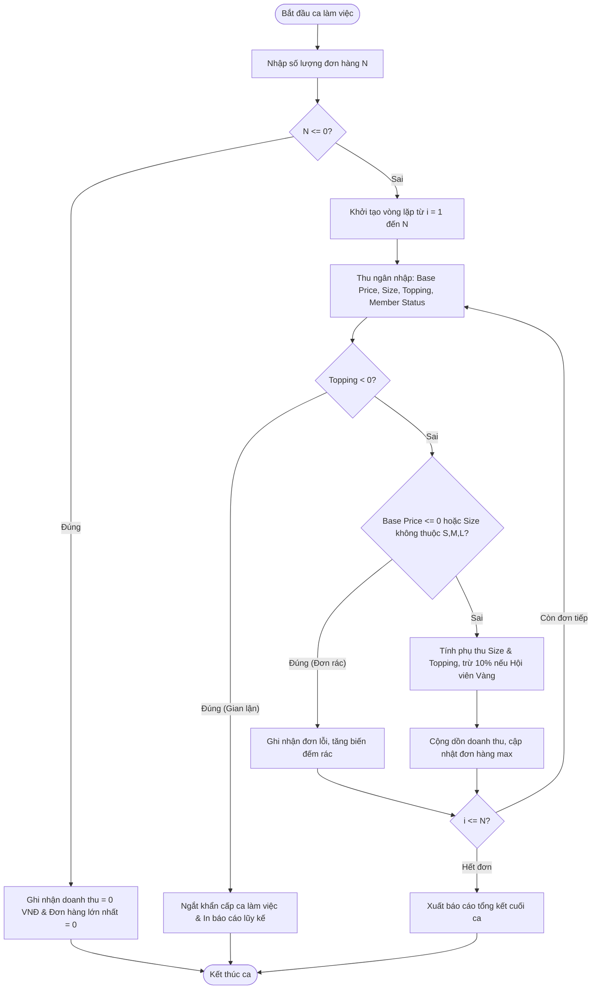

# BÁO CÁO PHÂN TÍCH HỆ THỐNG POS COFFEE VÀ MÃ NGUỒN TỰ CHỮA LÀNH DỮ LIỆU CA LÀM VIỆC

> 👤 **Học viên:** Hoàng Công Dũng | **Mã SV:** PTIT-HCM-009
> 🏫 **Môn học:** it102-rl-hoangcongdung

---

## 📊 Sơ đồ thiết kế hệ thống (Activity Diagram)

> 💡 *Sơ đồ dưới đây được render tự động trực tiếp trên GitHub bằng Mermaid. Bạn cũng có thể tải file **`bt2.drawio`** trong repository này để mở và chỉnh sửa trực tiếp trên [Draw.io (diagrams.net)](https://app.diagrams.net).* 

---

## Nhiệm vụ 1: Phân tích Input/Output và Kiến trúc Giải pháp

Trong phân hệ bán hàng và chốt sổ ca làm việc tại quầy POS, việc kiểm soát chặt chẽ luồng dữ liệu đầu vào là yếu tố then chốt để đảm bảo tính minh bạch tài chính. Dưới đây là bảng phân tích chi tiết các biến đầu vào và đầu ra của hệ thống.

- GitHub Organization nộp bài: it102-rl-hoangcongdung
- Đường dẫn thư mục: COFFEE_POS_Session04/bai7_chot_so_ca.c

| Tên biến / Dữ liệu | Kiểu dữ liệu | Phạm vi giá trị | Ý nghĩa nghiệp vụ trong ca POS |
| --- | --- | --- | --- |
| num_orders (N) | int | N >= 0 | Tổng số lượng hóa đơn phát sinh trong ca làm việc. |
| base_price | double | Thực tế > 0 | Giá niêm yết cơ sở của ly đồ uống tính theo Size S (VNĐ). |
| size_type | char | 'S', 'M', 'L', 's', 'm', 'l' | Ký tự phân loại kích cỡ đồ uống khách hàng gọi. |
| topping_count | int | >= -1 | Số lượng topping gọi thêm. Quy ước số âm là tín hiệu ngắt khẩn cấp. |
| is_member | int | 0 hoặc 1 | Trạng thái thẻ hội viên (1: Hội viên Vàng, 0: Khách hàng thường). |
| total_shift_revenue | double | >= 0 | Tổng doanh thu thực tế thu được từ các đơn hàng hợp lệ trong ca. |
| valid_order_count | int | >= 0 | Số lượng đơn hàng đã thanh toán thành công. |
| error_order_count | int | >= 0 | Số lượng đơn hàng rác/lỗi cú pháp bị hệ thống bỏ qua. |
| max_order_value | double | >= 0 | Giá trị tiền mặt lớn nhất của một đơn hàng thành công trong ca. |

## Nhiệm vụ 2: Thiết kế Giải pháp Xử lý Ngoại lệ và Tư duy Phòng thủ

Hệ thống POS trong thực tế thường xuyên đối mặt với tình trạng thu ngân thao tác nhầm lẫn hoặc các hành vi can thiệp phần cứng trái phép. Do đó, chương trình được thiết kế với 3 lớp phòng thủ nghiêm ngặt:

- Lớp 1 - Xử lý đơn rác (Lỗi cú pháp nhẹ): Khi giá cơ sở <= 0 hoặc ký tự size không nằm trong tập 'S', 'M', 'L', 's', 'm', 'l', hệ thống sẽ ghi nhận lỗi, tăng biến đếm rác và bỏ qua lệnh tính tiền của đơn hiện tại mà không làm sập ca làm việc.
- Lớp 2 - Phát hiện gian lận / Ngắt khẩn cấp: Khi phát hiện số lượng topping nhận giá trị âm (< 0), hệ thống nhận định đây là tín hiệu thiết bị bị xâm nhập hoặc lỗi nghiêm trọng. Luồng xử lý lập tức ngắt ngang, dừng nhận đơn mới và in ngay báo cáo lũy kế đến thời điểm đó.
- Lớp 3 - Xử lý ca làm việc trống: Trường hợp N <= 0 hoặc toàn bộ đơn trong ca đều là đơn rác, chương trình gán giá trị mặc định cho doanh thu và đơn hàng lớn nhất bằng 0 VNĐ, không gây lỗi chia cho không hoặc lỗi bộ nhớ.

## Nhiệm vụ 3: Lưu đồ thuật toán và Các bước thực hiện tuần tự

Quy trình xử lý tuần tự được thiết kế tối ưu bằng vòng lặp for trong hàm main, đáp ứng toàn bộ các ràng buộc kỹ thuật không sử dụng mảng, không dùng struct và không gọi hàm phụ.

| Bước | Hành động logic | Điều kiện kiểm tra | Trạng thái hệ thống tiếp theo |
| --- | --- | --- | --- |
| 1 | Nhập số lượng hóa đơn N | N <= 0 | Nếu đúng: Xuất báo cáo 0 VNĐ và kết thúc. |
| 2 | Khởi tạo vòng lặp duyệt từng đơn | i từ 1 đến N | Bắt đầu nhận thông tin từ thu ngân. |
| 3 | Kiểm tra tín hiệu bảo mật topping | topping_count < 0 | Nếu đúng: Break vòng lặp, dừng ca khẩn cấp. |
| 4 | Kiểm tra tính hợp lệ cú pháp size & giá | base_price <= 0 hoặc size không chuẩn | Nếu đúng: Bỏ qua đơn (continue), tăng biến đếm lỗi. |
| 5 | Tính toán chi phí phụ thu & giảm giá | Size M/L + Topping + 10% Gold | Cộng dồn vào tổng doanh thu ca. |
| 6 | Cập nhật đơn hàng lớn nhất | So sánh đơn hiện tại với max_order_value | Lưu giá trị lớn nhất nếu vượt qua mốc cũ. |
| 7 | Tổng kết ca làm việc | Kết thúc vòng lặp N đơn | In báo cáo doanh thu, số đơn hợp lệ và đơn lỗi. |

## Nhiệm vụ 4: Triển khai Mã nguồn Ngôn ngữ C hoàn chỉnh

Dưới đây là mã nguồn C chuẩn mực tuân thủ tuyệt đối các ràng buộc kỹ thuật của đề bài (viết toàn bộ trong main, không dùng mảng, không dùng struct, không dùng while/do-while).

---

## 📁 Danh sách tệp tin nộp bài trong Repository
- 📝 `bt2.docx`: Báo cáo tài liệu phân tích nghiệp vụ hoàn chỉnh.
- 🎨 `bt2.drawio`: File thiết kế sơ đồ chuẩn theo quy định đề bài (mở trực tiếp bằng [Draw.io](https://app.diagrams.net) hoặc Lucidchart).
- 💻 `bai7_chot_so_ca.c`: Mã nguồn chương trình.
